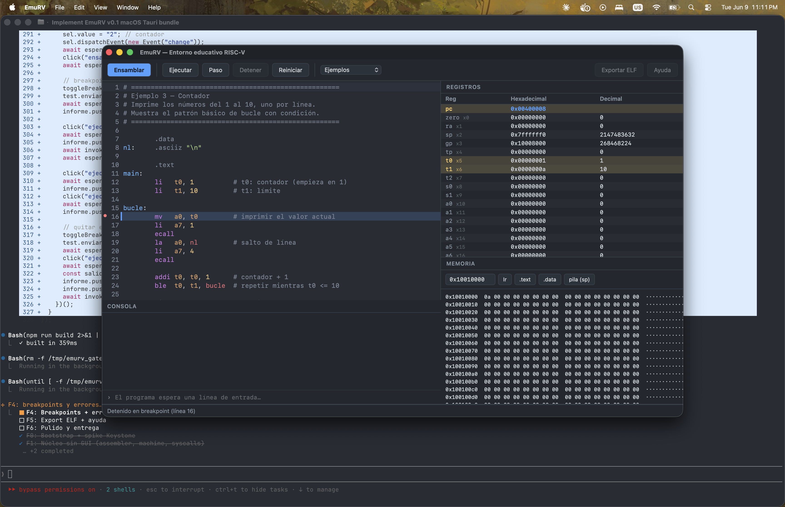

# EmuRV

<!-- Badge de CI: activar al crear el remote de GitHub (reemplazar OWNER/REPO).
[](https://github.com/OWNER/REPO/actions/workflows/ci.yml)
-->

Entorno educativo de programación en ensamblador **RISC-V (RV32IM)** para macOS, concebido como reemplazo moderno de emu8086: **editar → ensamblar → ejecutar / paso a paso → observar registros y memoria**, con mensajes de error en español pensados para principiantes.

Prototipo técnico de TFG — FIUNI, Ingeniería en Computación.



## Características

- Editor con resaltado de sintaxis **RV32IMAFDC** (incluye coma flotante, atómicas y comprimidas), números de línea y breakpoints por click en el margen.
- **Editor profesional**: autocompletado contextual (mnemónicos, registros y etiquetas del buffer; Ctrl-Espacio), ayuda al pasar el mouse sobre una instrucción (hover en español), e ir-a-definición de etiquetas (Cmd/Ctrl-click) con resaltado de sus usos.
- Ensamblador propio RV32IM (enteros + multiplicación/división) con errores **por línea y columna, en español**.
- Ejecución completa o paso a paso sobre [Unicorn Engine](https://www.unicorn-engine.org/); la línea por ejecutarse queda resaltada.
- Vista de registros (x0–x31 + pc, nombres ABI, hex y decimal) con **resaltado de los que cambiaron** en el último paso; orden estándar RISC-V (RARS/gdb), separadores sutiles entre grupos ABI y tooltip con el rol de cada registro.
- Vista de memoria navegable con accesos rápidos a `.text`, `.data` y la pila.
- **Paneles con divulgación progresiva** (pensado para principiantes): Registros siempre a la vista y prioritario; Memoria plegable; Depuración arranca plegada y se revela sola al poner el primer breakpoint, con los watchpoints (más avanzados) en una sub-sección con mini-ayuda. La barra de herramientas se adapta a cualquier ancho de ventana (los controles bajan de fila, no se cortan).
- **Modales (Ejemplos, Lecciones, Ayuda)**: la **Ayuda** es una referencia de dos columnas (índice agrupado con scroll-spy: ciclo de trabajo, syscalls, mapa de memoria, teclado MMIO, directivas, editor, depuración…) e incluye una sección **«Acerca de»** con créditos y licencias. **Ejemplos** es una lista; **Lecciones** muestra el currículo en dos columnas (la lista con tu progreso a la izquierda y, al elegir una, sus objetivos y qué paneles mirar a la derecha, con navegación anterior/siguiente). Todos cierran con Escape y devuelven el foco al control que los abrió.
- Consola integrada con syscalls estilo RARS (`ecall` con selector en `a7`): imprimir/leer enteros, cadenas, caracteres, terminar, tiempo en ms y dormir.
- **Teclado en tiempo real**: dispositivo MMIO compatible RARS/MARS (`0xFFFF_0000`) que el programa consulta por polling sin bloquearse — ver [`docs/TECLADO.md`](docs/TECLADO.md).
- Exportación a **ELF32 RISC-V estándar**, cargable en otras herramientas (p. ej. Ripes).
- 12 ejemplos comentados en español (uno multi-archivo), accesibles desde el botón «Ejemplos» — incluido un **Tetris gráfico**, port a RV32IM de un Tetris 8086 de la materia Microprocesadores, dibujado en la pantalla de 320×240, y su versión **en tiempo real** (teclado MMIO + gravedad por reloj).
- **Coma flotante (RV32F/D)**: repertorio completo de single y double, registros `f0`–`f31` con nombres ABI, syscalls 2/3/6/7, panel de registros flotantes; encodings verificados palabra a palabra contra GNU `as`.
- **Atómicas (RV32A) y comprimidas (RV32C)**: repertorio A completo (amoadd/lr/sc…, semántica mono-hart documentada) y C de 2 bytes (c.addi, c.li, c.lw… escritas a mano, sin compresión automática); ambas verificadas contra GNU `as`. RV64 queda fuera por decisión de alcance.
- Mapa de memoria compatible con RARS: `.text` en `0x00400000`, `.data` en `0x10010000`, `sp` inicial `0x7FFFFFF0`.
- **Interfaz en español o inglés**: selector de idioma en la barra (ES/EN), persistido. La UI cáscara está traducida; **los diagnósticos del ensamblador/runtime y el contenido de las lecciones siguen en español** también en modo inglés — decisión de alcance (el español es el material didáctico de la tesis), no un olvido.
- **Estética «Cálido»**: interfaz de paneles-tarjeta con aire, esquinas redondeadas y sombras suaves; tipografía de UI **IBM Plex Sans** (self-hosted, OFL) mientras el código y los datos de máquina siguen en JetBrains Mono; acento violeta en el tema por defecto; wordmark bi-tono en la barra que recolorea con el tema. Microinteracciones sutiles (foco con anillo de acento, destello único al cambiar un registro, caret de consola en acento, pista de breakpoint al pasar el mouse).
- **Temas**: selector en la barra con cinco temas — «Educativo» (oscuro sobrio, acento violeta, por defecto), «Retro-CRT» (fósforo ámbar con scanlines), «Pergamino» (papel cálido claro), «Retro Kawaii» (pastel vaporwave) y «Disquete 90s» (beige noventero). El cambio se aplica al instante (sin recargar), se recuerda y recolorea también la sintaxis del editor y el wordmark (CodeMirror sigue los tokens `--sx-*` del tema). Toda la estética vive en design tokens CSS (`src/temas/tokens.css`); el contraste de los cinco temas cumple WCAG AA (texto y sintaxis, verificado por test).

## Modo gráfico (Framebuffer VGA 13h)

**Rama `feature/framebuffer`** — Extensión experimental: pantalla gráfica estilo VGA modo 13h (320×240, paleta indexada de 256 colores), visible en el panel «Pantalla» de la app.

- **Framebuffer:** 320×240 píxeles, 1 byte por píxel (índice de paleta), mapeado en `0x9000_0000`.
- **Paleta:** 256 colores RGB888 en `0x9002_0000` — por defecto, los 16 CGA + rampa de grises; el programa puede reescribirla.
- **Vsync:** escribir 1 en `0x9003_0000` señala "frame listo".
- **Panel en la UI:** aparece solo cuando el programa usa la VRAM (o con el botón «Pantalla»); canvas con `image-rendering: pixelated`, refresco a ~30 Hz con flag sucio y bytes crudos por el puente (sin JSON).
- **Ejemplos:** «Franjas de color» (mínimo) y **«Tetris gráfico»**: el mismo Tetris port del 8086 de v0.1, ahora dibujando el tablero como bloques de color en la pantalla (la lógica de juego —LCG, colisiones, líneas, puntaje— es idéntica y está verificada por el mismo oráculo de tests).
- **Compatibilidad:** los programas sin gráficos no pagan ningún costo (RF4).

Detalles: ver [`docs/MEMORIA-GRAFICA.md`](docs/MEMORIA-GRAFICA.md) y [`BITACORA.md`](BITACORA.md) (decisiones técnicas, mediciones RF1-RF4).

## Teclado en tiempo real (rama `feature/teclado`)

Entrada interactiva sin bloquear el programa: un **dispositivo de teclado mapeado en memoria**, con las mismas direcciones y semántica que RARS/MARS (el material didáctico existente funciona sin cambios).

- **`RECEIVER_CONTROL` (`0xFFFF_0000`):** bit 0 en 1 cuando hay una tecla pendiente (el bit 1 —interrupciones— queda reservado: solo polling).
- **`RECEIVER_DATA` (`0xFFFF_0004`):** código de la tecla más vieja; **leerlo la consume**. Cola de 64 teclas con descarte de la más vieja.
- **Captura en la UI:** click en el canvas del panel «Pantalla» (o ventana de pantalla desacoplada); imprimibles ASCII, Enter (10), Esc (27), Backspace (8) y flechas (`0x80`–`0x83`).
- **Syscalls nuevas:** 30 (tiempo del sistema en ms, par `a1:a0`, reloj no decreciente) y 32 (dormir `a0` ms, interrumpible por «Detener»).
- **«Detener» responde siempre:** la ejecución corre en tramos de 1 M de instrucciones (~2-3 ms), así que hasta un `loop: j loop` se detiene al instante.
- **Ejemplos:** «Eco de teclado» (polling mínimo comentado) y **«Tetris en tiempo real»** (mismo motor del Tetris gráfico; a/d/w/s o flechas, gravedad por reloj).

Detalles completos —mapa MMIO, semántica exacta, tabla de códigos, decisiones de diseño con mediciones—: [`docs/TECLADO.md`](docs/TECLADO.md).

## Instalación

### Desde el bundle

Abrir `EmuRV.app` (o el `.dmg`) generado en `src-tauri/target/release/bundle/`. Requiere macOS en Apple Silicon.

> La app no está firmada/notarizada: la primera vez, click derecho → «Abrir» (o autorizarla en Ajustes del Sistema → Privacidad y seguridad).

### Compilar desde el código fuente

Requisitos comunes: [Rust](https://rustup.rs) (estable), Node.js ≥ 20, CMake y pkg-config (los exige la compilación de Unicorn).

**macOS:**

```bash
brew install cmake pkg-config
```

**Linux (Debian/Ubuntu):** además de cmake/pkg-config, las librerías de sistema de Tauri 2:

```bash
sudo apt update
sudo apt install -y cmake pkg-config build-essential curl wget file \
  libwebkit2gtk-4.1-dev libxdo-dev libssl-dev \
  libayatana-appindicator3-dev librsvg2-dev
```

(En Fedora: `webkit2gtk4.1-devel openssl-devel libappindicator-gtk3-devel librsvg2-devel`; en Arch: `webkit2gtk-4.1 base-devel openssl appmenu-gtk-module libappindicator-gtk3 librsvg`.)

### Dependencias de build por plataforma (resumen)

| Plataforma | Dependencias | Estado |
|---|---|---|
| macOS (Apple Silicon) | Xcode Command Line Tools (`xcode-select --install`) + `cmake` + `pkg-config` (Homebrew) | **Probado** — plataforma de desarrollo |
| Linux (Debian/Ubuntu) | Lista oficial de Tauri v2 (`libwebkit2gtk-4.1-dev build-essential curl wget file libxdo-dev libssl-dev libayatana-appindicator3-dev librsvg2-dev`) **+ `cmake` y `pkg-config`** | **SIN PROBAR** — pierna experimental del CI |
| Windows | Microsoft C++ Build Tools («Desktop development with C++») + WebView2 Runtime + CMake | **SIN PROBAR** — pierna experimental del CI |

`cmake` y `pkg-config` no los pide Tauri: los exige la compilación de **Unicorn Engine** (núcleo de emulación, build C vía CMake) — es el riesgo principal del port fuera de macOS ARM. Fuente de las listas: [tauri.app/start/prerequisites](https://tauri.app/start/prerequisites/) (verificada 2026-06-12).

**Compilar y ejecutar (igual en todas las plataformas):**

```bash
npm install
cargo install tauri-cli --locked   # una sola vez
cargo tauri build        # bundle en src-tauri/target/release/bundle/
# o, para desarrollo:
cargo tauri dev
```

En Linux el bundle sale como `.deb`/`.rpm`/AppImage según la distro. Nota: esta versión solo se probó en macOS Apple Silicon; el código es multiplataforma pero el build en Linux no está validado.

## Tu primer programa (5 minutos)

1. Abrí EmuRV. El editor ya trae el ejemplo «Hola mundo»:

```asm
        .data
saludo: .asciiz "¡Hola, mundo!\n"   # cadena terminada en NUL

        .text
main:
        la   a0, saludo     # a0 ← dirección de la cadena
        li   a7, 4          # servicio 4: imprimir cadena
        ecall               # llamada al sistema

        li   a7, 10         # servicio 10: terminar el programa
        ecall
```

2. **Ensamblar** — si hay errores, aparecen subrayados en el editor y listados en la consola, con línea y columna.
3. **Ejecutar** — la salida aparece en la consola integrada. O **Paso** para ir instrucción por instrucción mirando cómo cambian los registros (los modificados quedan resaltados).
4. Click en el margen izquierdo del editor para poner un **breakpoint** (punto rojo): «Ejecutar» se detiene ahí, antes de ejecutar esa línea.
5. **Reiniciar** vuelve la máquina al estado inicial (registros y memoria como recién ensamblado).

Probá después «Suma interactiva» (Ejemplos → escribe en la consola cuando el programa pide entrada), «Fibonacci» paso a paso, «Tetris gráfico» para un programa grande de verdad (tablero en memoria, bitmaps, colisiones, líneas completas, dibujado en la pantalla gráfica), y «Tetris en tiempo real» o «Eco de teclado» para jugar con el teclado MMIO (click en la pantalla gráfica para capturar las teclas).

## Aprendé RISC-V con EmuRV

¿Nunca programaste en ensamblador? EmuRV trae un **curso de 10 lecciones** pensado para un principiante absoluto sin docente al lado. Abrilo desde el botón **«Lecciones»** de la app: un modal de dos columnas con el currículo ordenado y tu progreso (barra + tildes de completadas, persistido) a la izquierda; al elegir una lección ves sus objetivos y qué paneles mirar a la derecha (con navegación anterior/siguiente) y **«Abrir lección»** carga el código al editor para recorrerlo con «Paso». También está en la carpeta [`lecciones/`](lecciones/README.md) para leerlo o correrlo por terminal. Cada lección es un programa comentado — el texto te dice qué mirar en cada panel ANTES de que pase, y cierra con 3 ejercicios.

El recorrido: registros → aritmética (con el complemento a 2 demostrado) → memoria (endianness ante tus ojos) → condicionales → bucles (con breakpoints condicionales) → funciones y pila → syscalls → proyectos multi-archivo → MMIO y tiempo real → traps (tu primer mini-kernel). El [índice](lecciones/README.md) tiene el mapa de aprendizaje y los prerrequisitos de cada una. Todas las lecciones corren también por terminal (`emurv-cli run lecciones/01-registros/leccion.s`) y están vigiladas por tests en la CI.

## Syscalls (convención RARS)

| a7 | Servicio | Argumentos |
|----|----------|------------|
| 1  | imprimir entero | `a0` = valor |
| 2  | imprimir float | `fa0` = valor (f32) |
| 3  | imprimir double | `fa0` = valor (f64) |
| 4  | imprimir cadena | `a0` = dirección de cadena NUL |
| 5  | leer entero | devuelve en `a0` |
| 6  | leer float | devuelve en `fa0` (NaN-boxed) |
| 7  | leer double | devuelve en `fa0` |
| 8  | leer cadena | `a0` = buffer, `a1` = tamaño (guarda ≤ `a1`−1 bytes + NUL; trunca sin error) |
| 9  | sbrk (reservar memoria) | `a0` = bytes → devuelve `a0` = dirección (heap en `0x10040000`, sin free) |
| 10 | terminar | — |
| 11 | imprimir carácter | `a0` = código |
| 30 | tiempo del sistema en ms | devuelve `a0` = bits bajos, `a1` = bits altos |
| 32 | dormir | `a0` = milisegundos (interrumpible con «Detener») |
| 60 | limpiar la consola | — (**extensión EmuRV**, no existe en RARS; en el CLI solo limpia si stdout es una terminal) |
| 93 | terminar con código (Exit2) | `a0` = código de salida |

El servicio **17** (Exit2 de MARS/MIPS) no existe en RARS ni en EmuRV: se
rechaza con un mensaje que apunta al 93.

Tabla completa, mapa de memoria y directivas: botón **Ayuda** dentro de la app.

### Directivas del ensamblador

| Directiva | Uso |
|---|---|
| `.text` / `.data` | sección de código / de datos |
| `.word .half .byte` | valores de 4/2/1 bytes (admiten etiquetas y constantes) |
| `.ascii .asciiz .string` | cadenas (con o sin NUL final) |
| `.space .align .globl` | reserva, alineación, símbolo global |
| `.include "archivo.s"` | inserta otro archivo (relativo al que lo contiene) |
| `.eqv` / `.equ` | constantes simbólicas (`.eqv VECES 3`) |
| `.macro … .end_macro` | macros con parámetros `%nombre` |
| `%hi(x)` / `%lo(x)` | partes alta/baja de una dirección para `lui`+`addi` |

El ejemplo `ejemplos/11-multiarchivo/` muestra todo junto (corre por CLI:
`emurv-cli run ejemplos/11-multiarchivo/main.s`; en la app, abrilo con «Abrir» —
los `.include` se resuelven desde la carpeta del archivo guardado).

## Uso por línea de comandos (`emurv-cli`)

El binario `emurv-cli` ensambla y ejecuta programas **sin interfaz gráfica** — útil para
corrección automática de tareas (diff sobre la salida), scripting y CI.

```sh
cd emurv-cli
cargo build --release
# el binario queda en emurv-cli/target/release/emurv-cli
```

(El CLI vive en un crate propio que consume el núcleo `emurv_lib` por path:
el empaquetador de Tauri incluye en la app TODO binario del paquete y eso
inflaba el bundle por encima del límite de RNF-04 — detalle en BITACORA.)

Subcomandos:

```sh
# Ensamblar y exportar un ELF32 RISC-V estándar:
emurv-cli asm ejemplos/01-hola-mundo.asm -o hola.elf

# Ensamblar y ejecutar, con la consola del programa en stdin/stdout:
echo "8
34" | emurv-cli run ejemplos/02-suma-interactiva.asm
# → imprime los textos del programa y "La suma es: 42"
```

Flags de `run`: `--max-instr N` (presupuesto de instrucciones) y `--timeout-s S`
(tiempo de pared; es el límite útil para los ejemplos de tiempo real, que en
headless no tienen teclado y duermen en su bucle de polling).

Reglas de canal: **stdout lleva exclusivamente la salida del programa invitado**
(apto para corrección por `diff`); todos los diagnósticos —errores de ensamblado
con su formato didáctico, errores de runtime, avisos de `ebreak`— van por stderr.

Códigos de salida: `0` programa terminado · `1` error de runtime o de E/S (incluye
EOF de stdin con el programa pidiendo entrada) · `2` error de ensamblado · `3` uso
inválido · `124` límite agotado (convención de `timeout(1)`).

El código que el programa invitado elige con la syscall **93** se propaga al
shell (`echo $?`), primero `& 0xFF` (estilo Unix: −1 → 255) y después acotado
a `0..=125` — 126/127/128+ tienen significado propio del shell; un exceso se
acota a 125 con aviso por stderr. **Limitación documentada:** si el invitado
elige 124, es indistinguible del 124 por límite agotado del propio CLI.

Ejemplo de corrección automática:

```sh
echo "8
34" | emurv-cli run entrega-alumno.asm > salida.txt 2>/dev/null
diff salida.txt esperado.txt && echo "APROBADO"
```

## Estructura del proyecto

```
src-tauri/src/core/   núcleo Rust: assembler, machine (Unicorn), syscalls, elf_export, video, keyboard
src-tauri/src/commands.rs   comandos Tauri + hilo de emulación
src/                  frontend TS: editor (CodeMirror 6), paneles, i18n
ejemplos/             los 12 programas de ejemplo
docs/                 contrato de trabajo del TFG y capturas
BITACORA.md           registro de decisiones técnicas (material de tesis)
```

```bash
cd src-tauri && cargo test     # suite completa (núcleo + integración de ejemplos)
```

## Abrir binarios ELF (import y desensamblador)

EmuRV carga ejecutables **ELF32 RISC-V** además de fuentes (RP11): en la app,
**«Abrir»** acepta `.elf` (la detección es por la firma del archivo, no por la
extensión); en terminal, `emurv-cli run programa.elf` y `emurv-cli debug
programa.elf` funcionan igual que con un fuente.

Al abrir un binario, el editor pasa a **modo binario**: muestra el listado
desensamblado de `.text` (solo lectura, banner «binario importado») y
Ejecutar/Paso/Reiniciar/breakpoints funcionan sobre las líneas del listado.
El panel «Memoria» muestra además la instrucción decodificada de cada palabra
de `.text` (también para fuentes normales).

Para compilar un C/asm propio con gcc y cargarlo en EmuRV:

```sh
brew install riscv64-elf-gcc   # macOS
riscv64-elf-gcc -march=rv32im -mabi=ilp32 \
  -Ttext=0x00400000 -Tdata=0x10010000 -nostdlib -o programa.elf programa.c
```

Esos flags son obligatorios (el mapa de memoria de EmuRV es el de RARS); un
ELF con otras direcciones, de 64 bits o PIE se rechaza con un error que
explica exactamente qué flag falta. Solo ET_EXEC con direcciones absolutas
(sin relocaciones/PIE ni DWARF); las syscalls siguen la convención RARS, no
la de Linux. Hay una fixture completa con su Makefile en
`src-tauri/tests/fixtures/rp11/`.

El desensamblador también está disponible como subcomando:

```sh
emurv-cli disasm programa.elf    # o un fuente .s
# 00400000:  00a00893  addi a7, zero, 0xa
# 00400004:  00000073  ecall
```

## Traps y CSRs (Zicsr)

El programa puede instalar su **propio manejador de excepciones** (`csrw
mtvec, t0` + `mret`): los ecall desconocidos, las instrucciones ilegales y
los accesos inválidos se delegan al manejador, como en un kernel real —
con doble falta detectada y mensajes didácticos. Ejemplo:
`ejemplos/12-trap-handler.asm`. Detalle: [`docs/TRAPS.md`](docs/TRAPS.md).

## Depuración remota (GDB)

`emurv-cli debug programa.s` levanta un **servidor GDB remoto** (protocolo
gdbserver): conectá `riscv64-elf-gdb` o VS Code por TCP y depurá con
breakpoints **por nombre de etiqueta** (el ELF exportado lleva símbolos),
paso a paso, registros y memoria. La app de escritorio no cambia (la feature
`gdb` solo entra en el CLI). Guía completa, sesión de referencia y
limitaciones: [`docs/DEPURACION-GDB.md`](docs/DEPURACION-GDB.md). Las herramientas didácticas
integradas (watchpoints, breakpoints condicionales, edición en vivo desde el
panel «Depuración»): [`docs/DEPURACION.md`](docs/DEPURACION.md).

## Integración continua

El workflow `.github/workflows/ci.yml` define 4 jobs: **test-macos** (obligatorio: frontend `tsc`+`vite build`, `cargo test` y `clippy -D warnings` en `src-tauri/` y `emurv-cli/`, build release del CLI), **bundle-macos** (obligatorio: `npx tauri build` + gate automático de peso ≤ 30 MB, RNF-04) y **build-linux**/**build-windows** (experimentales, `continue-on-error`: su log de fallos es el insumo del port fuera de macOS).

El repo es solo local por ahora: el workflow está validado con `actionlint` pero nunca corrió en GitHub (checklist de activación al final del propio `ci.yml`). El **espejo local** ejecuta los mismos comandos en esta máquina:

```sh
scripts/ci-local.sh                # todo (tests + clippy + bundle + gate de peso)
scripts/ci-local.sh --skip-bundle  # solo tests y clippy (el bundle tarda)
```

## Licencia / alcance

Prototipo académico (v0.1). Primera iteración: macOS Apple Silicon; la base es multiplataforma (Tauri) pero los builds de Windows/Linux quedan fuera de esta versión.
